# Hatch

**A store for Linux and Windows apps on Android.** Search, tap Install, and the app gets its own Home screen icon and opens in a floating window over whatever you're doing. Hatch is built for arm64 phones and foldables (developed against the Galaxy Z Fold 8). No root, no Termux and no VNC desktop.

## Screenshots

Galaxy Z Fold profile (pixel_fold, 2208×1840) Android emulator, from CI (`android-emu-e2e`, `emu-blender`, `arm64-guest-proof`).

| | |
|---|---|
| 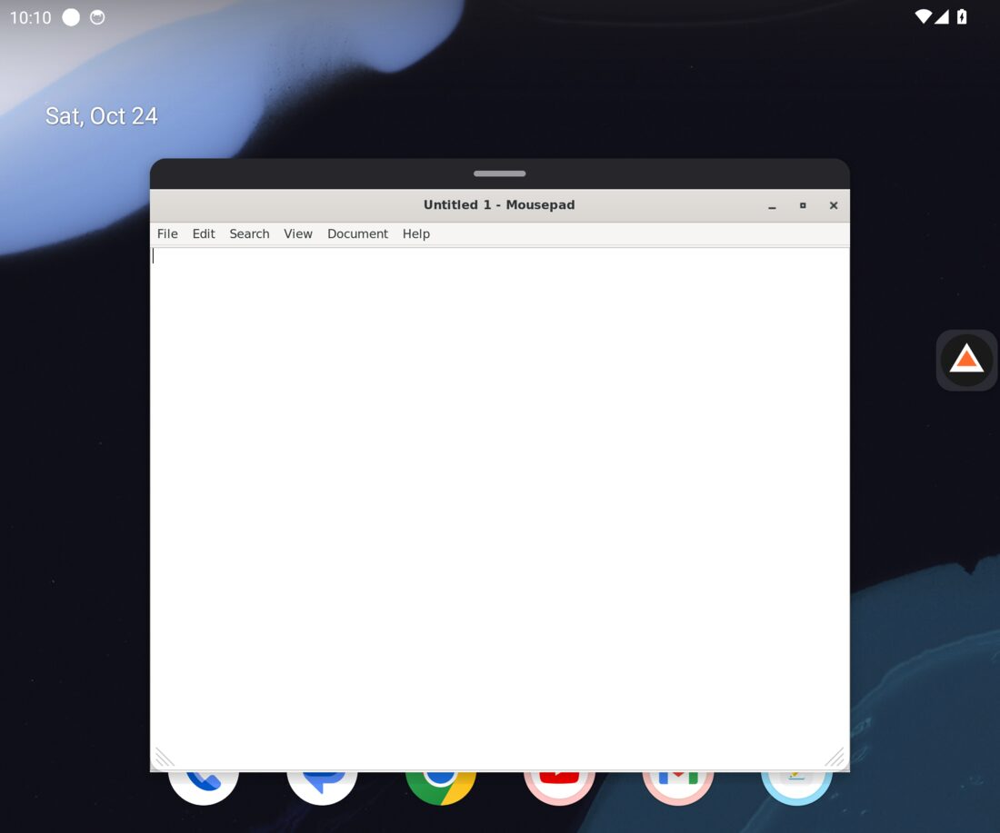 Mousepad floating over the home screen | 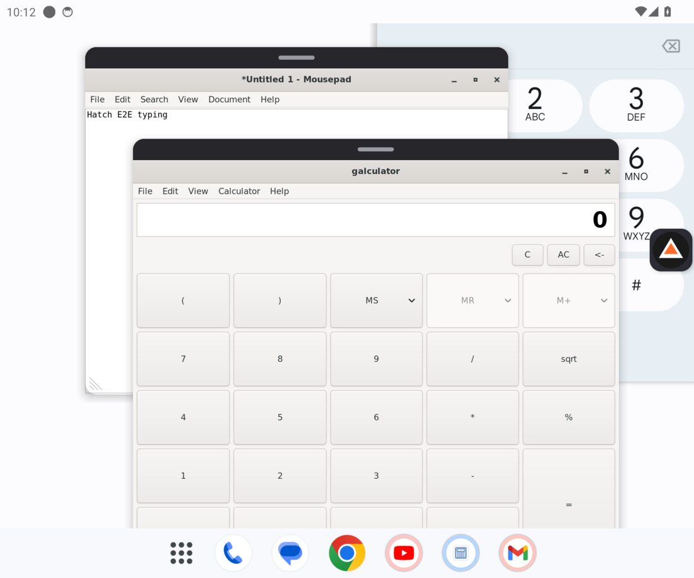 Two windows at once over another app |
| 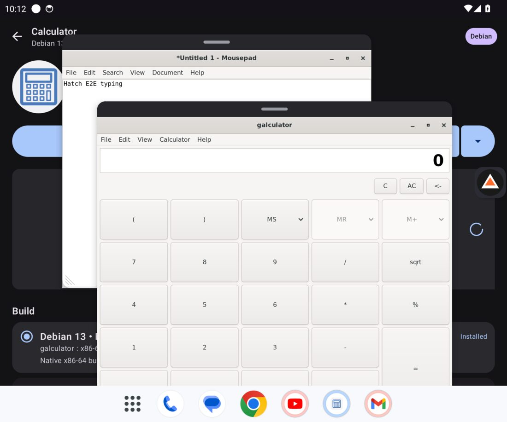 The store open while both keep running | 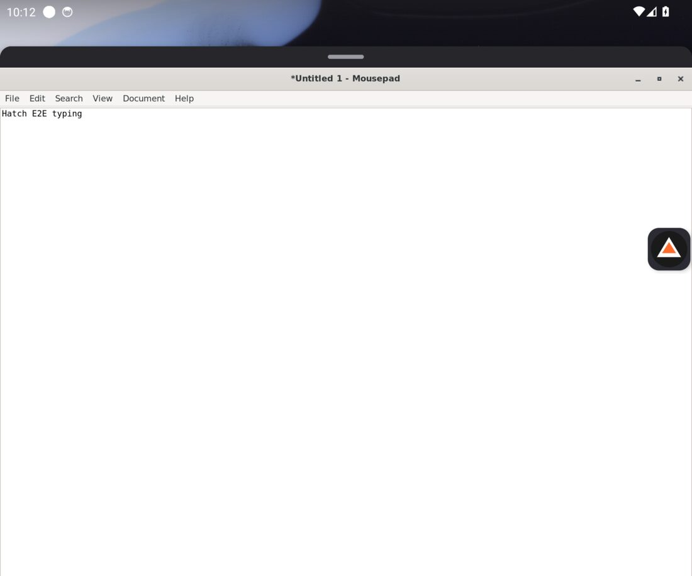 Maximised (restore returns to the exact frame) |
| 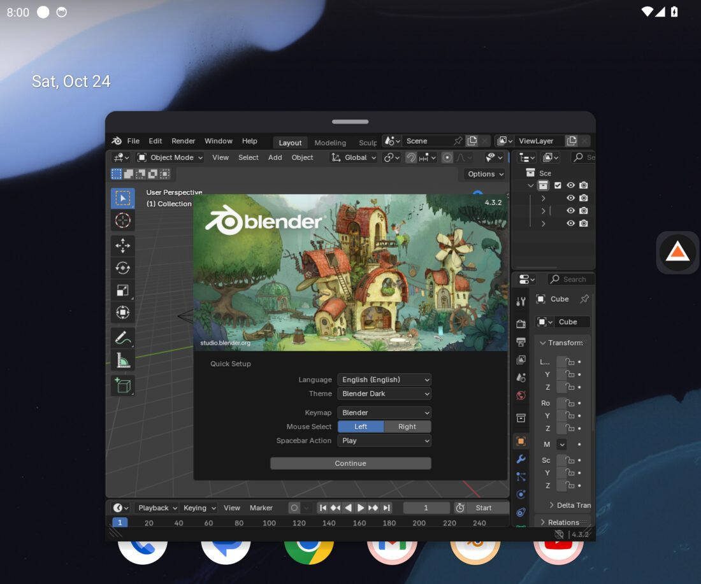 Blender (X11 via Xwayland) floating | 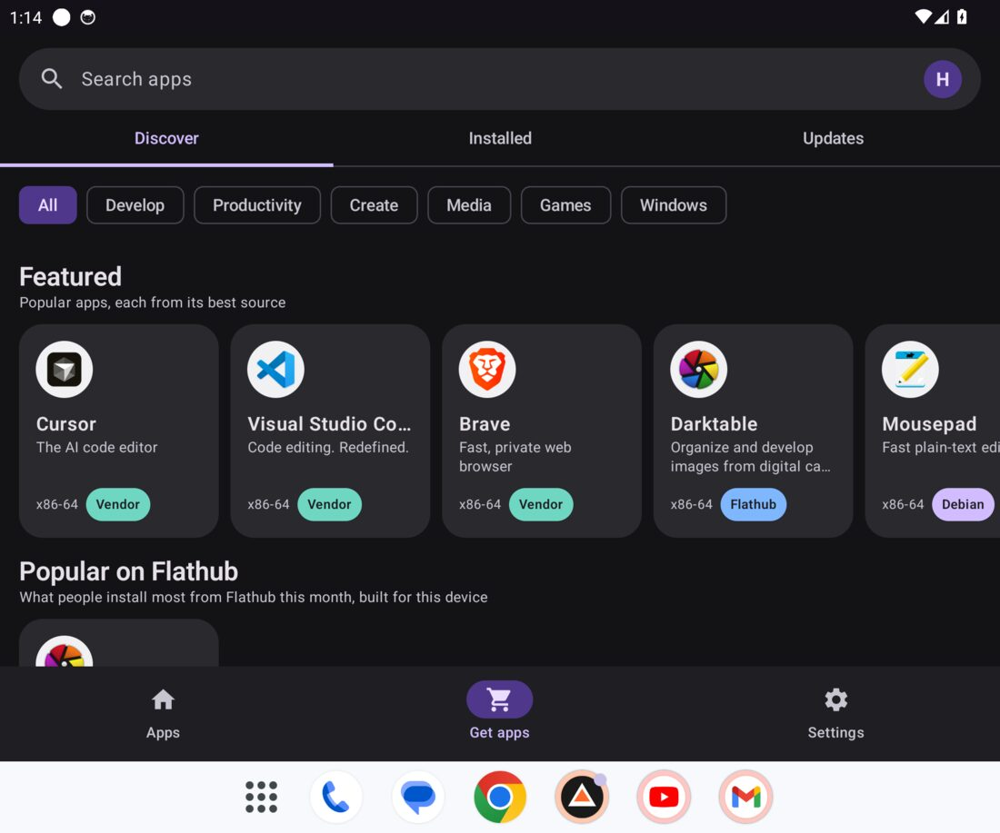 Get apps |
| 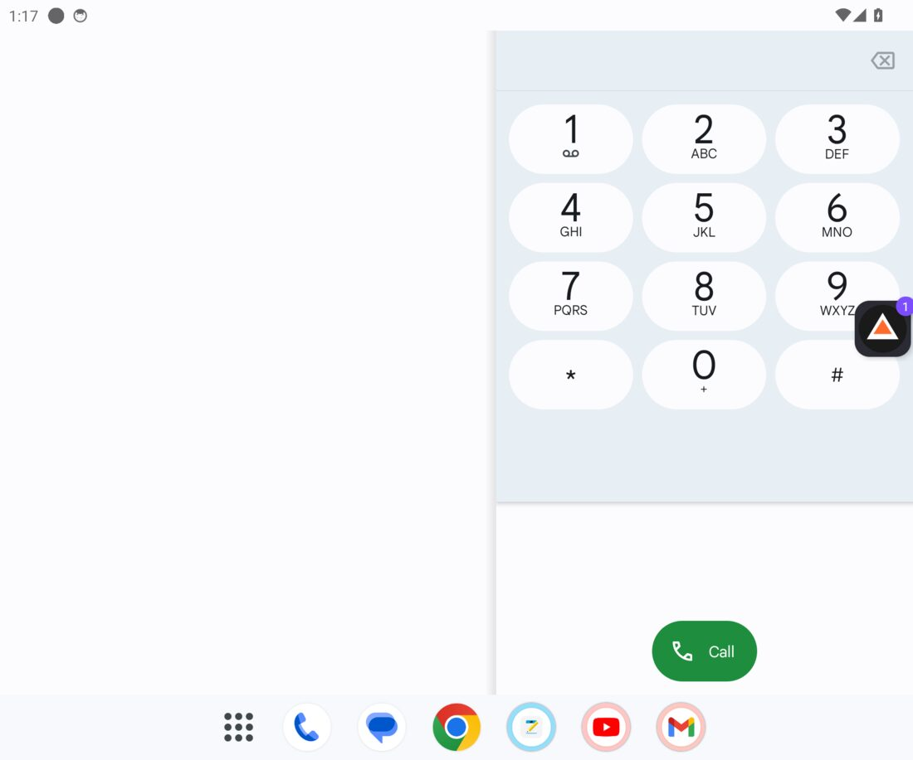 Minimised to the edge bubble | 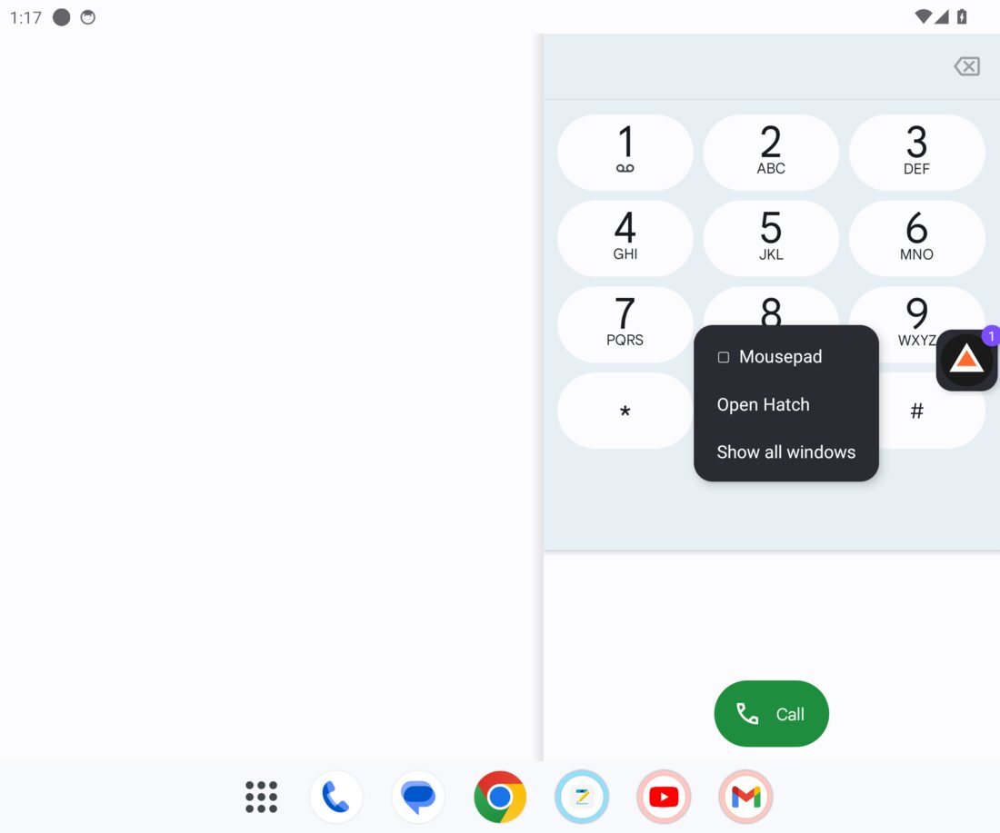 Bubble menu: windows, Open Hatch |

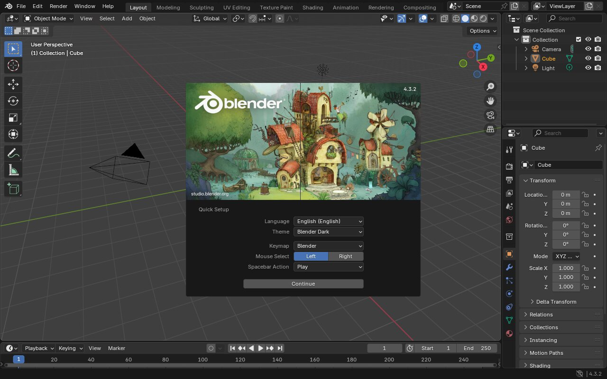
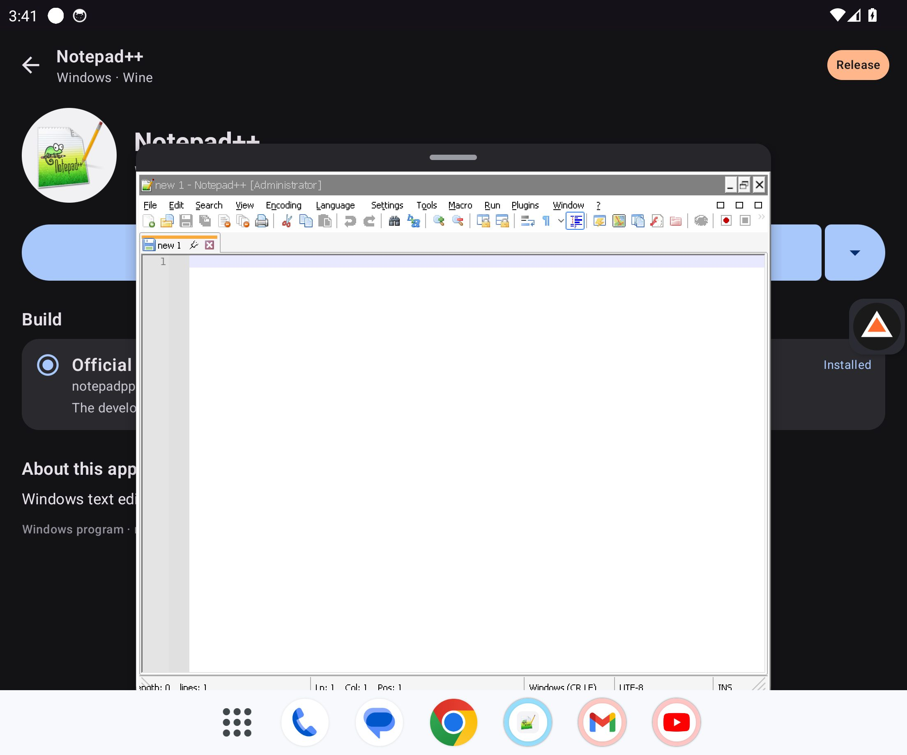
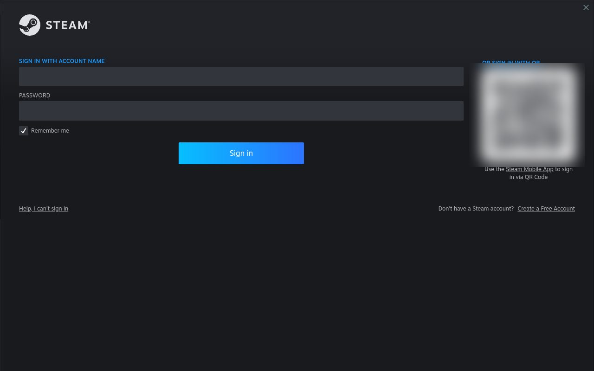
Blender on the GPU path (GL → Zink → Vulkan → software present → Xwayland → Hatch), with lavapipe standing in for Turnip on the arm64 CI runner.

## What it does

- **Store** (dark Material 3, bottom nav **Apps · Get apps · Settings**):
  - Discover / Installed / Updates tabs, category chips, and Featured / Popular on Flathub / Windows apps / Classics rows.
  - Every app shows its architecture and a coloured **source pill**: Debian, Flathub, Vendor, Release.
- **First run**: one designed onboarding flow (notification and floating-window permissions are steps in it), then a one-pass setup: Hatch streams a prebuilt Debian 13 image (about 130 MB → 490 MB) straight to disk, with real MB, percent and time left, and the raw log behind **Details**.
- **Detail page**: a blue **Install**, or **✓ Open** with a dropdown for Add to home screen, Update and Uninstall. Uninstall shows how much space it frees, and removes only the packages no other app needs.
- **Settings → Storage & reset**: Linux and cache sizes, uninstall any app (with its size), clear the download cache, **Remove all apps** (keeps Linux) and **Remove Linux and all apps** (type DELETE to confirm; returns to first run).
  - Install progress is a squiggly bar driven by apt itself ("31% : Downloading 121 of 192 MB", "201 MB to download - 1.0 GB on disk"), with Cancel.
  - A **Build** picker covers the same app from several sources (one marked Recommended), plus About this app.
- **Sources**, each verified:
  - **Debian 13**: about 1,950 desktop apps from AppStream, through apt.
  - **Vendor apt repositories**: Cursor (Anysphere), VS Code (Microsoft), Brave. The vendor's key is added with a deb822 entry, and updates arrive with Update all.
  - **Flathub**: Flatpak deploys the app; Hatch runs it without bubblewrap through proot, using Flatpak's own runtime → /usr and app → /app layout.
  - **Developer releases**: AppImages unpacked without FUSE (e.g. HDRView).
  - **Windows programs**: Debian's arm64 Wine (winewayland.drv), e.g. Notepad++ ARM64.
- **Home screen icons without APKs**: each install is pinned to the Home screen as a launcher shortcut with the app's own icon (and recent apps show up as long-press shortcuts on Hatch's icon). Nothing extra is installed, so there is no Play Protect scan and no "Install unknown apps" prompt. Shortcuts open the same floating window as the store's Open button. A per-app stub APK (shows in the app drawer) is still available as an advanced setting, off by default.
  - Hatch's own updates still go through Android's package installer: that is the only way to update an app outside a store, so updating Hatch itself asks for "Install unknown apps" once.
- **Running apps notification**: "2 apps running: Blender, VS Code" with **Stop all** (closes every app and leaves nothing running) and **Open Hatch**. It goes away by itself about 10 seconds after the last app closes.
- **Windows**:
  - Each program window is a **floating overlay window** above other apps and the home screen. It has a pill handle, drag-to-move, corner and pinch resize, minimise-to-bubble, maximise and close.
  - Several windows can be open at once. Wine programs keep their Win32 frame.
  - A chat-head **edge bubble** collects minimised windows and opens the store.
  - Windows belong to a foreground service, so programs keep running while the store is open on top. An Activity-per-window (freeform) mode remains as a Settings option.
- **Hatch's own Wayland compositor** covers touch, mouse, keyboard + IME, popups and menus, clipboard both ways, output scale and fold resizes. X11-only apps (Blender, xterm) go through Xwayland. Audio goes guest PulseAudio → AudioTrack.
- **Graphics**: llvmpipe everywhere (one thread per core); Blender renders its full UI on it. On Adreno, Hatch bundles Mesa **Turnip (KGSL)**, self-tests it on first run, and uses Zink when the test passes. X11 apps reach Zink through Xwayland without DRI3 (drisw/kopper).

## How it works

1. **Debian 13 rootfs** under PRoot (shipped as `libproot.so`).
   - Prebuilt by CI (`rootfs.yml`, `scripts/build-rootfs.sh`): `debian:trixie` plus [rootfs/base-packages.txt](rootfs/base-packages.txt) (Xwayland, Mesa, fonts, audio, the `hatch` user), exported as `.tar.zst`. Published as a `rootfs-YYYYMMDD` prerelease with an Ed25519-signed `rootfs-manifest.json`; the app pins the URL and sha256.
   - The app streams it in one pass (download → sha256 → zstd → `TarExtractor`), writing symlinks, permissions and hard links in proot's link2symlink layout. No temporary archive, no proot tar, no apt.
   - Fallback: linuxcontainers' newest build (SHA256SUMS), then Debian's official Docker Hub image (digest), through proot tar + apt.
   - Apps run as a normal user (`hatch`); installs run as fake root.
2. **Guest scripts** (`app/src/main/assets/guest-bin`) do all the installing and launching. CI runs the very same scripts inside a Debian 13 arm64 rootfs, so what CI proves is what ships.
3. **Compositor** (`dev.hatch.wayland`, C + Kotlin): each `xdg_toplevel` is backed by a SurfaceView. That's an overlay window from `FloatingWindows` by default, or a `WindowActivity` in tasks mode.
4. **Flathub without bubblewrap**: `hatch-flatpak` writes a spec (skeleton root, binds, env) that `FlatpakSpec.kt` and `scripts/guest-run.sh` turn into a proot invocation. A bwrap stub makes glycin and WebKit fall back cleanly instead of hanging.

## Tests

| Layer | What runs | Where |
|---|---|---|
| Unit + screenshots | Roborazzi screenshots of onboarding, the detail page and Storage for a phone and the unfolded Fold; tar extractor (pax/GNU, link2symlink hard links, path escapes); wipe leaves only prefs; uninstall package selection; Stop-all process filter; catalogue and payloads per arch, signed remote catalogue (Ed25519 verify, fallback, schema skip), vendor repo argv, Flatpak spec, Docker Hub index parsing, apt progress parsing, failure reasons, window geometry, keymaps, popup placement, GPU selection, per-phone stub signing (apksig-verified) | `./gradlew :app:testDebugUnitTest` |
| Host compositor | `weston-simple-shm` against the Hatch compositor | CI `host-wayland-proof` |
| arm64 guest | Each catalogue app is installed with the real guest scripts in Debian 13 arm64 and rendered by the Hatch compositor (screenshot + colour check). Coverage: mousepad, galculator, gnome-mines, xterm, featherpad, gnome-chess, Notepad++ (Wine), Blender, Cursor, Brave, Darktable (Flathub). Also input injection, menus, clipboard both ways, audio PCM, and the GPU path proxy: glxgears and Blender on Zink over Vulkan (lavapipe for Turnip) vs llvmpipe, with viewport FPS. | CI `arm64-guest-proof` |
| Emulator E2E | Onboarding (folded + unfolded) → setup time → store → search → detail → Install → launcher pin sheet → Home screen icon → floating window over the home screen → drag-move, corner resize, typing, fold resize → two windows over another app → minimise to bubble and restore → store on top → maximise/restore → Wine program → Stop all from the notification (no processes, overlays or wakelocks left) → uninstall from the detail page → Remove Linux and all apps (only prefs left) | CI `android-emu-e2e` (x86_64 emulator, pixel_fold) |

Blender floating has its own job, CI `emu-blender`. Device-only checks (Adreno Turnip, Samsung IME, real fold hinge) are listed in [docs/DEVICE-VERIFY.md](docs/DEVICE-VERIFY.md).

## Building

```bash
# JDK 17, Android SDK + NDK
./scripts/fetch-proot.sh
./gradlew :app:assembleDebug        # app/build/outputs/apk/debug/
```

Release builds are signed from `keystore.properties` (not in git). CI publishes **draft** releases only.

## Removing Hatch

Everything Hatch sets up (Debian, apps, Wine and Flatpak data, downloads) lives in its own app storage. Uninstalling Hatch from Android Settings → Apps removes all of it, including the Home screen icons it pinned. **Settings → Storage & reset → Remove Linux and all apps** does the same without uninstalling Hatch. If you turned on per-app stub APKs, remove those too (the reset asks Android to remove them).

Third-party notices: [NOTICE.md](NOTICE.md).
